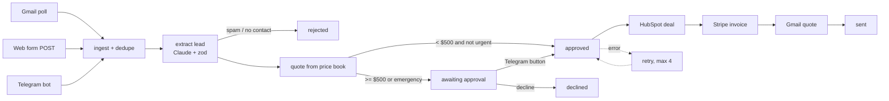

# workflow-automation-agent


Turns inbound service requests into sent quotes for a small HVAC/plumbing shop. A lead comes in
from Gmail, a web form or Telegram. Claude pulls out the details, the shop's price book prices it,
and anything big or urgent waits for a human to tap Approve in Telegram. After that it creates the
HubSpot deal and the Stripe invoice and emails the quote.

The model is only used for extraction. Pricing, approval rules and side effects are plain code,
so the same message always produces the same quote. Every step is written to an event log.



## Details

- **Dedupe.** Each message gets a key from channel + provider id. Gmail redeliveries, Telegram
  retries and double-submitted forms all map to the same job.
- **Retries.** If HubSpot or Stripe fails, the job stays in its state and the cron tick retries it.
  After 4 attempts it goes to `failed`. Stripe calls send idempotency keys, so a retry never
  creates a second invoice.
- **Approval.** Quotes of $500 or more, and anything marked emergency, go to a Telegram chat
  with Approve and Decline buttons. Clicks from any other chat are ignored.
- **Storage.** SQLite (sql.js, no native build) when running on Node, D1 on Cloudflare Workers.
  Both use the same SQL and the same `migrations/`.
- **Runs in two places.** `src/app.ts` is a plain `fetch(Request)` handler. `server.ts` wraps it
  for Node and `worker.ts` for Workers, with a cron trigger for the Gmail poll and retries.

## Running

```bash
npm install
cp .env.example .env     # any key you leave blank uses a fake
npm test
npm start                # :8787
curl -X POST localhost:8787/inbound/webform -H 'x-api-key: change-me' \
  -H 'content-type: application/json' \
  -d '{"id":"1","body":"Kitchen sink clogged, 773-555-0119"}'
```

| endpoint | |
|---|---|
| `POST /inbound/:channel` | `{id, from, subject?, body}`, channel is email, webform or telegram |
| `POST /hooks/telegram` | Telegram webhook (checks the secret token header) |
| `POST /jobs/:id/approve`, `/decline` | manual decision |
| `GET /jobs?state=`, `GET /jobs/:id` | job plus its event log |

Cloudflare:

```bash
npx wrangler d1 create wfa            # put the id in wrangler.toml
npx wrangler d1 migrations apply wfa
npx wrangler secret put ANTHROPIC_API_KEY   # same for the rest of .env.example
npx wrangler deploy
```

## Evals

`evals/leads.jsonl` has 32 labeled messages: maintenance contracts, emergencies, water heaters,
installs, vague texts, and spam (SEO, loans, guest posts). The script scores each extracted field
and spam precision/recall. It fails if overall accuracy drops below the threshold or if a single
spam message gets through, or a single real lead gets marked as spam.

| | command | where |
|---|---|---|
| keyword extractor | `npm run eval` | CI |
| Claude | `npm run eval -- --real` | locally / `eval-real-llm` workflow (manual) |

The keyword extractor scores about 95% of fields on this set. It's there as a baseline and a
no-key fallback, and it still gets some cases wrong: it reads "not urgent" as urgent and labels
appliance requests as plumbing. The point of the set is to compare it against Claude and to catch
regressions when the prompt changes.

## Layout

```
src/app.ts             routes + cron tick
src/pipeline.ts        state machine
src/extract.ts         Claude + keyword extractors
src/pricebook.ts       example price book
src/integrations.ts    HubSpot, Stripe, fakes
src/adapters/          Gmail (OAuth refresh, poll, send), Telegram (approval buttons, webhook)
src/store.ts           memory + SQL store; sqlite.ts (Node), D1 in worker.ts
evals/                 labeled leads + scorer
```

## Not done yet

- Postgres store (the SQL is close, just needs `$1`-style params)
- Gmail push via Pub/Sub instead of polling
- Price book loaded from a sheet instead of code
- Small dashboard for the job log

MIT
